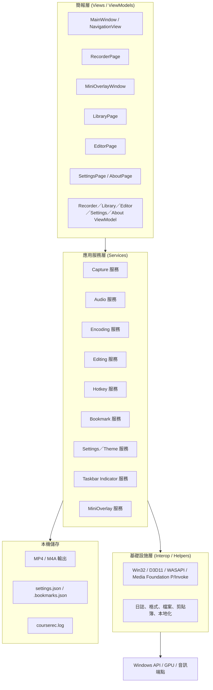
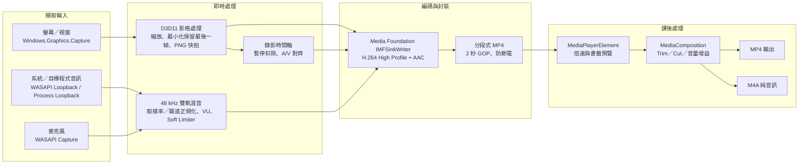

# CourseRec 系統架構與技術文件

本文件描述 CourseRec 的技術基線、分層架構、影音管線、執行緒模型、資料儲存與錯誤處理。系統設計取捨請參閱 [系統設計文件](DESIGN.md)。

---

## 1. 技術基線

| 項目 | 內容 |
| :--- | :--- |
| 語言 | C#（nullable、file-scoped namespace） |
| 執行環境 | .NET 10（`net10.0-windows10.0.19041.0`） |
| UI | WinUI 3 / Windows App SDK 1.8 |
| MVVM | `CommunityToolkit.Mvvm` + `Microsoft.Extensions.Hosting` |
| 架構 | x64、ARM64 |
| 最低系統 | Windows 10 1809（Build 17763） |
| 影音 | `Windows.Graphics.Capture`、WASAPI / Process Loopback、Media Foundation、`Windows.Media.Editing` |
| 第三方影音 | 無（不使用 FFmpeg 或外部編碼器） |
| 測試 | xUnit |

套件版本集中於 `Directory.Packages.props`；編譯設定集中於 `Directory.Build.props`，啟用 `Nullable` 與 `TreatWarningsAsErrors`。

---

## 2. 分層架構

依賴方向一律由簡報層指向服務層；View 不直接 `new` 服務，所有服務與 ViewModel 於 `App.xaml.cs` 的 `IHost` 容器註冊（多數為 singleton，`MainWindow` 為 transient）。

---

## 3. 啟動與生命週期

1. `Program.Main` 以具名 `Mutex` 確保單一實例；重複啟動時設定 `EventWaitHandle`，由既有執行緒帶回主視窗。
2. 初始化 `ComWrappersSupport`，建立 `DispatcherQueueSynchronizationContext`，再啟動 `App`。
3. `App` 以 `Host.CreateDefaultBuilder` 建立 DI 容器，載入 `appsettings.json`，設定 `FileLoggerProvider`。
4. `OnLaunched` 啟動主機、載入設定、套用主題、建立 `MainWindow`、註冊全域快捷鍵與工作列指示；迷你控制列不隨啟動顯示，改由錄影工作台切換。
5. 關閉時先關閉迷你控制列，再同步等待 `Host.StopAsync`（上限 3 秒）並 `Dispose`，確保日誌佇列與錄影資源完成收尾。
6. 未處理例外：
   - UI 執行緒：`Application.UnhandledException` 顯示可複製診斷資訊的 `ContentDialog` 後結束。
   - 背景：`AppDomain.UnhandledException` 與 `TaskScheduler.UnobservedTaskException` 寫入日誌。

---

## 4. 影音管線

### 4.1 畫面擷取

- 使用 `Windows.Graphics.Capture` 的 `GraphicsCaptureItem` 與 `Direct3D11CaptureFramePool`。
- 影格經 GPU 處理與 readback，依目標解析度縮放，避免每幀配置大型陣列。
- 指定視窗最小化時無法取得新影格，服務會重送最後一幀並通知 ViewModel。
- PNG 快拍由目前影格轉為 BGRA 點陣圖，存檔後透過 UI 執行緒複製到剪貼簿。

### 4.2 音訊擷取

- 系統聲音：WASAPI Loopback，使用 `AUDCLNT_STREAMFLAGS_AUTOCONVERTPCM` 允許驅動端轉換。
- 單一視窗：`ActivateAudioInterfaceAsync` + Process Loopback（Windows 10 Build 20348+ / Windows 11）。
- 麥克風：WASAPI Capture；純聽課模式在混音器層直接靜音並清除緩衝。
- 所有輸入正規化為 48 kHz、雙聲道交錯浮點：
  - 單聲道複製到左右聲道。
  - 5.1／7.1 將中央聲道以 −3 dB 折疊，保留語音。
- `DualTrackAudioMixer` 以環形緩衝吸收排程抖動，提供即時峰值與 clipping 指示。
- Soft Limiter 於 0.85 以下維持線性，超過後平滑壓縮至 1.0，避免兩軌疊加破音。

### 4.3 編碼與封裝

- `IMFSinkWriter` 寫入 H.264 視訊與 AAC 音訊。
- 視訊使用 High Profile、2 秒 GOP；省空間預設限制 1080p / 15 fps。
- 封裝為分段式 MP4，降低斷電造成整檔損毀的風險。
- 錄影時間軸由 `RecordingTimelineClock` 管理，暫停時間不計入輸出。
- 編碼或封裝失敗會明確回報，不將失敗誤判為成功。

### 4.4 課後剪輯與匯出

- `MediaComposition` 依 Trim／Cut 區間建立 `MediaClip`，必要時套用音量增益。
- 未變更音量時使用 `MediaTrimmingPreference.Fast` 快速通道。
- 匯出先寫入暫存檔，成功後才取代正式檔；取消或失敗保留原檔。
- M4A 匯出為 48 kHz、Mono、96 kbps AAC，適合語音辨識與 AI 摘要。
- 書籤時間依剪除區間重新計算，確保匯出後標記仍精準。

---

## 5. 服務與模組

| 模組 | 介面／實作 | 職責 |
| :--- | :--- | :--- |
| 擷取 | `ICaptureEnumerationService` / `CaptureEnumerationService` | 螢幕與視窗列舉、圖示、程序 ID |
| 畫面 | `IScreenCaptureService` / `ScreenCaptureService` | 擷取工作階段、預覽、快拍、最小化處理 |
| 音訊 | `IAudioCaptureService` / `AudioCaptureService` | WASAPI Loopback／Process Loopback／麥克風、端點變更 |
| 混音 | `DualTrackAudioMixer`、`AudioRingBuffer` | 正規化、混音、VU、Soft Limiter |
| 編碼 | `IMp4EncoderService` / `Mp4EncoderService` | MF SinkWriter、時間軸、分段封裝 |
| 剪輯 | `IMediaEditingService` / `MediaEditingService` | 預覽、Trim／Cut、MP4／M4A 匯出 |
| 書籤 | `IBookmarkService` / `BookmarkService` | `.bookmarks.json` 讀寫、時間平移 |
| 快捷鍵 | `IGlobalHotkeyService` / `GlobalHotkeyService` | `RegisterHotKey`、視窗訊息掛鉤 |
| 設定 | `ISettingsService` / `SettingsService` | 設定讀寫、局部更新、驗證 |
| 主題 | `IThemeService` / `ThemeService` | 顯示模式與色彩主題、DWM 深色標題列 |
| 工作列 | `ITaskbarIndicatorService` / `TaskbarIndicatorService` | 錄影中紅色圓點疊加 |
| 導覽 | `INavigationCoordinator` / `NavigationCoordinator` | 頁面導覽與參數傳遞 |

ViewModel 使用 `CommunityToolkit.Mvvm` 的 `ObservableObject`、`[ObservableProperty]` 與 `RelayCommand`，不手寫 `INotifyPropertyChanged`。

---

## 6. 執行緒模型

| 工作 | 執行緒／排程 |
| :--- | :--- |
| UI 與 XAML | WinUI UI 執行緒（STA） |
| 畫面擷取 | Graphics Capture 影格事件 + D3D11 |
| 音訊擷取 | WASAPI 擷取執行緒 + 環形緩衝 |
| 編碼 | Media Foundation 工作佇列 |
| 剪輯／匯出 | `Task.Run` 背景工作，進度回報至 UI |
| 設定／書籤 I/O | 非同步檔案 I/O，寫入序列化 |
| 日誌 | 有界背景佇列批次寫入 |

規則：

- UI 執行緒不做檔案或影音 I/O。
- 函式庫層使用 `ConfigureAwait(false)`；UI 層不加。
- 跨執行緒更新 UI 一律經 `DispatcherQueue`。
- 剪貼簿僅在 UI／ASTA 執行緒操作，統一由 `ClipboardHelper` 處理。

---

## 7. 資料儲存與格式

### 7.1 設定

`%AppData%\CourseRec\settings.json`，由 `AppSettings` 序列化。包含輸出路徑、主題、預設情境／畫質、倒數、自動停止、視窗位置、迷你控制列位置、檔名前綴、上次編輯影片與位置、快捷鍵等。

局部更新（例如外觀或播放位置）在 I/O 鎖內執行「讀取→修改→寫入」，避免快速切換互相覆蓋。

### 7.2 書籤

與錄影同名的 `.bookmarks.json`，由 `BookmarkDocument` 與 `BookmarkItem` 描述。重新命名影片時會同步更新書籤檔名。

### 7.3 錄影與快拍

- 影片：`<前綴>_<日期>_<時間>.mp4`
- 快拍：錄影檔旁 `Snapshots` 資料夾中的 PNG
- 匯出：MP4 或 M4A，先寫暫存檔再取代

### 7.4 日誌

`%AppData%\CourseRec\logs\courserec.log`：

- 有界背景佇列，批次寫入，重複訊息彙總。
- 5 MB 輪替為 `.prev`。
- 佇列滿載或磁碟不可用時不阻塞錄影，恢復後記錄遺失筆數。
- 關閉時排空佇列。

---

## 8. Interop 與平台相容

`Interop/` 集中宣告原生 API，避免散落於服務程式碼：

- `CaptureNativeMethods`、`CaptureIconNativeMethods`：視窗列舉與圖示。
- `D3D11NativeMethods`：Direct3D 裝置與紋理。
- `WasapiNativeMethods`：音訊端點與 Process Loopback。
- `MediaFoundationNativeMethods`：SinkWriter 與媒體類型。
- `HotkeyNativeMethods`、`WindowNativeMethods`：快捷鍵、視窗樣式、`WDA_EXCLUDEFROMCAPTURE`、DWM。
- `ExecutionStateNativeMethods`：`SetThreadExecutionState`。
- `ITaskbarList3`、`TaskbarNativeMethods`：工作列進度與疊加圖示。

平台差異以執行階段能力判斷：

- Process Loopback 不支援時降級為系統全體聲音。
- DWM 深色標題列不支援時維持系統預設。
- Windows 10 1809 不支援部分主題 API 時採安全降級。

ARM64 使用相同程式碼與原生 API，發行時以 `win-arm64` RID 與 `PlatformTarget=ARM64` 建置。

---

## 9. 錯誤處理與可靠性

- 使用者可見訊息一律本地化，原始例外只寫入日誌。
- 錄影啟動前驗證輸出資料夾可建立、可寫入。
- 音訊裝置失效或切換時重建端點，不中斷錄影。
- GPU 裝置遺失時重建 D3D11 與擷取工作階段。
- 錄影書籤於維護週期自動保存；編碼失敗明確提示。
- 全域例外顯示可複製診斷資訊的對話框（版本、來源、時間、HRESULT、日誌路徑）。
- 關閉流程同步等待資源釋放，避免日誌遺失。

---

## 10. 效能設計

- 影格以 GPU 縮放與 readback，降低 CPU 複製與大型物件堆配置。
- 音訊以環形緩衝與 `ArrayPool` 重用緩衝，避免即時執行緒配置。
- 檔案庫以檔案與時長中繼資料建立檢視，延後縮圖解析。
- 檔案庫搜尋與排序在背景整理，避免 UI 卡頓。
- 待機關閉預覽時停止背景擷取，節省 GPU 與記憶體。
- 日誌批次寫入與訊息彙總，降低磁碟 I/O。

---

## 11. 建置與發行

- 除錯與測試使用 `Debug`；`Release` 僅於明確發行時使用。
- 非 Self-Contained 發行需目標機器安裝 .NET 10 Desktop Runtime；Windows App SDK 以 `WindowsAppSDKSelfContained=true` 隨附。
- 產物：
  - `CourseRec-<版本>-win-x64-framework-dependent.zip`
  - `CourseRec-<版本>-win-arm64-framework-dependent.zip`
- 詳細指令與檢查清單見 [BUILD.md](BUILD.md)。

---

## 12. 測試策略

`tests/CourseRec.Tests` 以 xUnit 驗證不依賴 UI 的核心邏輯：

- 雙軌混音、取樣率轉換、Soft Limiter 與 VU 行為。
- 書籤時間軸平移與剪輯區間計算。
- 設定序列化與局部更新。
- 錄影可靠性與時間軸時鐘。
- 影格縮放、日誌與圖示擷取。

UI、GPU、WASAPI 與 Media Foundation 需於實機人工驗證；專案以 `dotnet build`、`dotnet test`、`dotnet format --verify-no-changes` 作為基本品質閘門。
