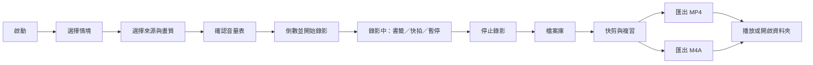
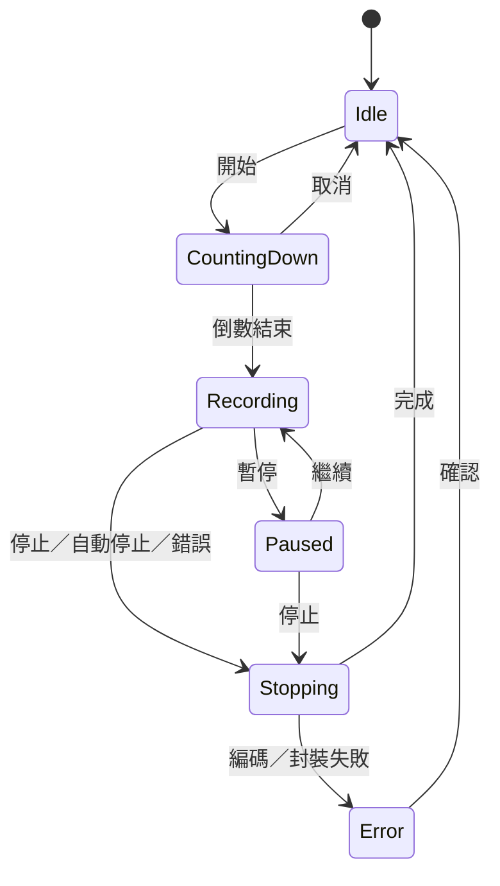
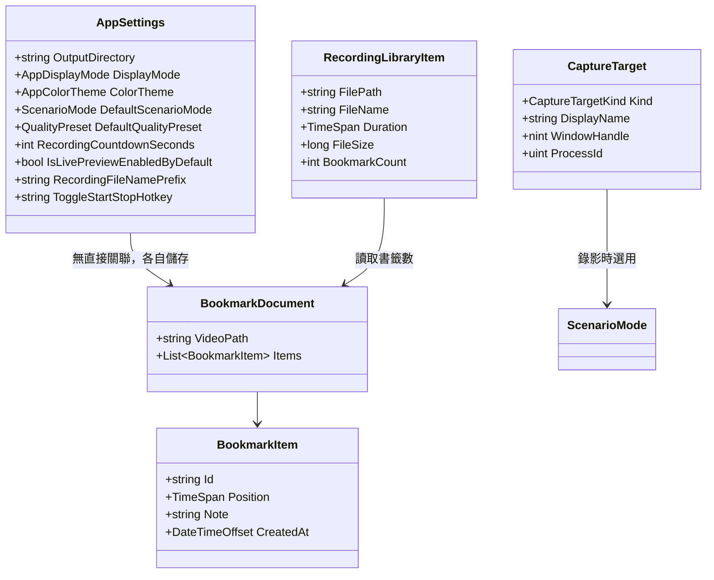

# CourseRec 系統設計文件

本文件說明 CourseRec 的設計目標、使用情境、互動流程、狀態模型、資料設計與關鍵取捨。技術實作細節請參閱 [系統架構與技術文件](ARCHITECTURE.md)。

---

## 1. 設計目標

1. **課後複習優先**：錄影不是終點，能快速找到重點、剪掉等待與中場休息、匯出給 AI 摘要才是主要價值。
2. **低門檻、零外掛**：不要求使用者安裝 FFmpeg 或額外編碼器，解壓即用。
3. **長時間錄影可靠**：線上課程常長達 1～3 小時，必須處理斷電、暫停、裝置切換與磁碟不足。
4. **省空間但不犧牲文字清晰度**：投影片課程以 15 fps 與合理碼率錄製，兼顧檔案大小與可讀性。
5. **隱私優先**：所有資料留在本機，不上傳、不收集遙測。

### 非目標

- 不做多軌影音剪輯、字幕燒錄或特效。
- 不支援 macOS、Linux、x86 或 Windows 10 1809 以下的系統。
- 不提供雲端同步、帳號或安裝程式。
- 不以直播串流為目標。

---

## 2. 目標使用者與情境

| 使用者 | 情境 | 關鍵需求 |
| :--- | :--- | :--- |
| 學生 | 線上課程複習 | 只錄課程聲音、重點書籤、快速剪掉中場休息 |
| 遠距工作者 | 視訊會議記錄 | 同時錄系統與麥克風、隔離通知音、匯出逐字稿音訊 |
| 講師 | 錄製教材 | 鎖定簡報視窗、省空間、快拍投影片 |
| 研究者 | 訪談／講座 | 穩定長錄、書籤備註、檔案庫整理 |

---

## 3. 核心使用流程



### 3.1 首次啟動

1. 建立 `%AppData%\CourseRec`。
2. 載入預設設定（海洋藍主題、純聽課、省空間、倒數 5 秒）。
3. 若無輸出資料夾，使用使用者影片資料夾下的 `CourseRec`。
4. 進入錄影工作台，顯示雙音量表與來源狀態。

### 3.2 錄影流程

1. 選擇情境 → 選擇來源 → 選擇畫質與倒數。
2. 啟動前檢查輸出資料夾、磁碟空間、擷取裝置與麥克風。
3. 倒數期間可取消；開始後設定電源需求、顯示工作列指示、套用快捷鍵。
4. 錄影中可暫停、書籤、快拍、使用迷你控制列。
5. 停止後關閉擷取與編碼、恢復電源需求、更新檔案庫、提示結果。

### 3.3 複習流程

1. 由檔案庫開啟快剪。
2. 以倍速播放並用書籤跳轉。
3. 設定頭尾保留與中場刪除區間。
4. 選擇 MP4 或 M4A 匯出。
5. 匯出成功後播放或開啟資料夾。

---

## 4. 錄影狀態模型



設計要點：

- **Idle**：可預覽、可監看音量，不寫入檔案。
- **CountingDown**：已建立輸出檔但尚未寫入；取消需清理暫存。
- **Recording**：時間軸前進，書籤與快拍可用。
- **Paused**：時間軸凍結，暫停時間不計入輸出。
- **Stopping**：停止擷取、排空編碼器、完成封裝；此時不接受新操作。
- **Error**：保留已完成內容（若可），明確告知失敗原因。

主視窗標題、工作列圖示與迷你控制列皆反映目前狀態。

---

## 5. 頁面設計

### 5.1 主視窗

- `NavigationView` 左側導覽，設定與關於置於底部。
- 標題列顯示錄影狀態與時間。
- 關閉前若有錄影或未匯出剪輯，顯示確認對話框。
- 記住視窗位置、大小、最大化狀態與上次頁面。

### 5.2 錄影工作台

- 左欄：情境、來源、畫質、倒數、定時停止、輸出路徑與磁碟資訊。
- 右欄：預覽、雙音量表、來源狀態、書籤清單、快捷鍵摘要。
- 主要動作：開始／停止、暫停／繼續、書籤、快拍、迷你控制列。
- 錯誤以 `InfoBar` 顯示，成功訊息自動消失。

### 5.3 迷你控制列

- 由錄影工作台切換顯示；關閉程式時自動關閉。
- 顯示狀態、時間、系統與麥克風音量。
- 可拖曳；預設排除於擷取畫面。
- 停止錄影後仍保持顯示待命；關閉按鈕可收起控制列。
- 位置會保存，重新開啟時還原。

### 5.4 檔案庫

- 清單／卡片式檢視，顯示縮圖、檔名、時長、大小、書籤數。
- 搜尋、排序、合計資訊。
- 主動作「開啟快剪」；次要動作收於 `…` 選單。
- 刪除需二次確認。

### 5.5 快剪與複習

- 播放器、時間軸、書籤清單、剪輯設定、匯出按鈕。
- 匯出進度與目前增益可見。
- 離開或載入其他影片前確認未匯出的變更。

### 5.6 設定與關於

- 設定分組：外觀、錄影、輸出、快捷鍵。
- 輸入驗證即時回饋，外觀即時套用。
- 關於頁顯示版本、授權、資料夾連結與複製版本資訊。

---

## 6. 資料模型



### 6.1 設定欄位

| 欄位 | 說明 |
| :--- | :--- |
| `OutputDirectory` | 錄影輸出資料夾 |
| `DisplayMode` / `ColorTheme` | 系統／淺色／深色與色彩主題 |
| `DefaultScenarioMode` | 純聽課／參與會議 |
| `DefaultQualityPreset` | 省空間／標準流暢 |
| `RecordingCountdownSeconds` | 0～30 秒 |
| `DefaultAutoStopMinutes` | 0 表示不限 |
| `IsLivePreviewEnabledByDefault` | 待機是否預覽 |
| `ExcludeOverlayFromCapture` | 迷你控制列是否排除擷取 |
| `IsolateWindowAudioByDefault` | 預設只錄目標視窗聲音 |
| `RecordingFileNamePrefix` | 檔名前綴 |
| `LastEditorVideoPath` / `LastEditorPositionTicks` | 上次複習進度 |
| `LibrarySortOrder` / `LastPage` | 介面狀態 |
| 快捷鍵欄位 | 四個全域快捷鍵 |

### 6.2 檔案命名

```text
<前綴>_<yyyyMMdd>_<HHmmss>.mp4
<前綴>_<yyyyMMdd>_<HHmmss>.bookmarks.json
Snapshots\<前綴>_<yyyyMMdd>_<HHmmss>_<HHmmss>.png
```

前綴會移除 Windows 無效字元與多餘空白；空白時回退為 `Course`。

---

## 7. 關鍵設計決策

| 決策 | 選項 | 選擇與理由 |
| :--- | :--- | :--- |
| 影音管線 | FFmpeg vs 原生 API | 原生 API：免額外二進位、授權單純、與 Windows 擷取整合佳 |
| 錄影格式 | MKV vs MP4 | MP4：相容性高；以分段封裝降低損毀風險 |
| UI 框架 | WPF vs WinUI 3 | WinUI 3：Fluent 風格、Windows App SDK 原生擷取整合 |
| 音訊處理 | 直接寫入 vs 混音 | 混音：統一取樣率與聲道，避免裝置差異造成失敗 |
| 防爆音 | 硬限幅 vs Soft Limiter | Soft Limiter：保留動態並避免破音 |
| 匯出策略 | 直接覆寫 vs 暫存後取代 | 暫存後取代：失敗不損毀既有檔案 |
| 書籤儲存 | 資料庫 vs 同名 JSON | 同名 JSON：可攜、易備份、與影片一起移動 |
| 設定儲存 | 登錄 vs JSON | JSON：可讀、可備份、免登錄權限 |
| 發行方式 | 安裝程式 vs zip | zip：免安裝、免簽章負擔；代價是需自備 .NET Runtime |
| AI 音訊 | 直接取 MP4 音軌 vs 獨立 M4A | 獨立 M4A：檔案小、格式符合 Whisper／NotebookLM |

---

## 8. 錯誤與邊界情境

| 情境 | 設計行為 |
| :--- | :--- |
| 輸出資料夾不可寫 | 啟動前驗證並阻止錄影，顯示可修正訊息 |
| 磁碟空間不足 | 提前警告；低於安全值時停止並保留已完成內容 |
| 目標視窗最小化 | 重送最後一幀、提示使用者，維持 A/V 同步 |
| 目標視窗關閉 | 停止錄影並保留檔案，提示原因 |
| 音訊裝置切換 | 重建端點，短暫靜音但不中斷錄影 |
| GPU 裝置遺失 | 重建 D3D11 與擷取工作階段 |
| 麥克風被占用 | 顯示不可用狀態；參與會議模式可改為純聽課 |
| 編碼失敗 | 明確標示失敗，不將檔案視為成功 |
| 程式被強制關閉 | 分段 MP4 降低損毀；日誌可能缺少最後訊息 |
| 設定檔損毀 | 回退預設值並記錄警告 |

---

## 9. 安全與隱私

- 無網路功能、無遙測、無帳號。
- 不記錄影音內容；日誌只含狀態與錯誤。
- 檔案操作限制在使用者選擇的資料夾與 `%AppData%\CourseRec`。
- 不載入外部程式碼或外掛。
- 剪貼簿操作僅在使用者主動快拍或複製診斷資訊時發生。

---

## 10. 無障礙與在地化

- 使用者可見文字集中於 `Strings/zh-Hant/Resources.resw`，預設繁體中文。
- 可點擊元素提供 `AutomationProperties.Name`；圖示按鈕提供工具提示。
- 主要操作可用鍵盤完成；快捷鍵可自訂。
- 間距以 4 的倍數、圓角 8；色彩集中於主題資源字典。

---

## 11. 風險與限制

| 風險 | 影響 | 緩解 |
| :--- | :--- | :--- |
| Process Loopback 僅支援新版 Windows | 舊版無法隔離通知音 | 自動降級並提示 |
| 原生 Media Foundation 行為因驅動而異 | 少數機器編碼失敗 | 明確錯誤、日誌、可改用標準預設 |
| 無安裝程式與簽章 | SmartScreen 提示 | 文件說明；未來可考慮簽章 |
| ARM64 尚未廣泛實機驗證 | 可能出現平臺差異 | 提供獨立 zip，回報後修正 |
| 長時間錄影仍可能受斷電影響 | 最後片段損毀 | 分段 MP4、2 秒 GOP |
| UI 自動化測試不足 | 回歸風險 | 核心邏輯單元測試 + 人工驗證清單 |

---

## 12. 後續演進

- 匯出佇列與批次處理。
- 書籤匯出為章節標記（MP4 chapters）。
- 多語系資源（en-US、ja-JP）。
- 錄影排程與自動分段。
- 簽章發行與 winget 套件。
- ARM64 實機驗證與效能調校。
