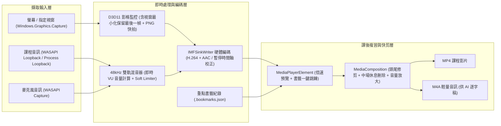

# CourseRec — Windows 線上課程／會議錄影與快剪工具實作計畫

本計畫依據專案規範 [AGENTS.md](../AGENTS.md) 制定，採用 **.NET 10 (`net10.0-windows10.0.19041.0`) + WinUI 3 + MVVM** 與 **純 Windows 原生影音管線**（免外掛 FFmpeg），打造專為「線上課程／視訊會議」最佳化的高穩定、省空間、好複習桌面錄影工具。

---

## 1. 專案基本設定與目錄結構

- **專案／應用名稱**：`CourseRec`
- **命名空間／組件名稱**：`Com.VibeCode.CourseRec`
- **支援架構與系統**：`x64`、Windows 10 1809（Build 17763）以上（部分進階 API 如「單一視窗獨立錄音」於 Windows 10 Build 20348+ / Windows 11 自動啟用，舊版自動降級為系統全體聲音）
- **套件集中管理（`Directory.Packages.props`）**：
  - UI 與基礎框架：`Microsoft.WindowsAppSDK`、`Microsoft.Windows.SDK.BuildTools`、`CommunityToolkit.Mvvm`
  - 啟動、設定與日誌：`Microsoft.Extensions.Hosting`、`Microsoft.Extensions.DependencyInjection`、`Microsoft.Extensions.Options.ConfigurationExtensions`、`Microsoft.Extensions.Logging`
  - 單元測試：`Microsoft.NET.Test.Sdk`、`xunit`、`xunit.runner.visualstudio`

```text
src/CourseRec/
  Views/
    MainWindow.xaml              # 主視窗（含 NavigationView、最小尺寸限制、關閉前防呆確認）
    MiniOverlayWindow.xaml       # 迷你懸浮錄影控制列（支援排除自身擷取 WDA_EXCLUDEFROMCAPTURE）
    RecorderPage.xaml            # 錄製工作台（情境模式、來源預覽、即時雙音量表、定時停止）
    LibraryPage.xaml             # 錄影檔案庫（清單、時長、大小、書籤數、快剪入口）
    EditorPage.xaml              # 快剪與複習編輯器（倍速播放、書籤跳轉、頭尾/分段剪除、匯出 MP4/M4A）
    SettingsPage.xaml            # 設定與關於（儲存路徑、快捷鍵、顯示主題、版本資訊）
  ViewModels/                    # 對應各頁面的 ObservableObject ViewModel
  Models/                        # CaptureTarget、RecordingProfile、BookmarkItem、TrimSegment、AppSettings 等
  Services/
    Capture/                     # GraphicsCapture 螢幕/視窗枚舉與影格擷取、最小化偵測、PNG 快拍
    Audio/                       # 原生 WASAPI Loopback（含單一視窗 Process Loopback）+ 麥克風混音 + VU Meter
    Encoding/                    # Media Foundation IMFSinkWriter 硬體 H.264/AAC 編碼與安全封裝
    Editing/                     # Windows.Media.Editing (MediaComposition) 剪輯合併與 M4A 純音訊匯出
    Hotkeys/                     # Win32 RegisterHotKey 全域快捷鍵管理
    Bookmarks/                   # 隨附 .bookmarks.json 讀寫與剪輯後時間戳自動校正
    Settings/                    # %AppData%/CourseRec/settings.json 讀寫與主題切換服務
  Interop/                       # Win32 / Direct3D11 / WASAPI / Media Foundation COM P/Invoke 宣告
  Helpers/                       # 時間格式、檔案大小轉換器、ResourceLoader 多語系輔助
  Strings/zh-Hant/Resources.resw # 繁體中文 UI 字串資源（全數透過 x:Uid / ResourceLoader 存取）
  Styles/                        # 共用控制項樣式與 Styles/Themes/ 淺深色主題資源字典
tests/CourseRec.Tests/           # 核心邏輯單元測試（書籤時間軸平移、剪輯區間計算、設定序列化、混音防爆音）
CourseRec.sln
Directory.Build.props
Directory.Packages.props
docs/DEV_LOG.md
docs/IMPLEMENTATION_PLAN.md
README.md / CHANGELOG.md / RELEASE_NOTES.md
```

---

## 2. 純 Windows 原生影音核心架構



> [!IMPORTANT]
> **針對「線上課程／會議」的四大關鍵技術設計：**
> 1. **簡報省空間編碼預設**：提供「簡報／會議省空間（1080p 上限、15 fps、動態低碼率）」與「標準流暢（原生解析度、30 fps）」兩檔預設，讓靜態投影片為主的 1 小時課程控制在數百 MB 內且文字清晰。
> 2. **背景視窗鎖定與最小化防呆**：鎖定會議／瀏覽器視窗時，上層覆蓋筆記軟體不影響錄影；若目標視窗被最小化至工作列，自動重送最後一幀維持影音同步並彈出提示，防止編碼管線中斷。
> 3. **單一視窗隔離錄音**：於支援的 Windows 版本透過 `ActivateAudioInterfaceAsync` 只擷取目標視窗程序（Process ID）的聲音，徹底過濾 LINE／系統通知音；並監聽音訊端點變更，耳機切換不斷線。
> 4. **剪輯後書籤自動對齊**：在快剪編輯器刪除開場等待或中場休息片段後，系統會自動重新計算並平移剩餘書籤的時間點，確保匯出後的重點標記依然精準。

---

## 3. 介面規劃與操作閉環

1. **錄製工作台 (`RecorderPage` + `MiniOverlayWindow`)**
   - **一鍵情境切換**：`🎧 純聽課模式`（自動開啟課程聲音、強制關閉麥克風防環境雜音）與 `🎙️ 參與會議模式`（同時開啟課程聲音與麥克風）。
   - **來源與預覽**：切換「全螢幕（支援多螢幕）」或「指定視窗（附「只錄此視窗聲音」開關）」，提供即時畫面預覽。
   - **即時雙音量表**：未開錄即可看到「課程聲音」與「麥克風」的即時跳動條，杜絕錄完無聲慘劇。
   - **無人值守與監控**：可設定「定時自動停止（如 60 / 90 / 120 分鐘）」，即時顯示磁碟剩餘空間與預估可錄時長。
   - **錄影中互動**：支援 `開始（含 3 秒倒數）`、`暫停／繼續`、`停止`、`📌 打時間書籤（可填簡短備註）`、`📸 投影片快拍（存 PNG／複製剪貼簿）`；開錄後可切換至不入鏡的迷你懸浮控制列。
2. **錄影檔案庫 (`LibraryPage`)**
   - 卡片式列出歷史錄影（顯示縮圖／圖示、時長、檔案大小、書籤數），一鍵開啟檔案位置、進入快剪複習或確認後刪除。
3. **快剪與複習編輯器 (`EditorPage`)**
   - **高效複習**：內建 `0.75x ~ 2.0x` 倍速播放、書籤清單點擊跳轉、一鍵擷取當前簡報頁為圖片。
   - **直覺剪輯**：設定頭尾保留區間（Trim），並可標記多段「待剪除區間（Cut，例如中場休息 15 分鐘）」與人聲音量增強（100% ~ 200%）。
   - **雙用途匯出**：可選擇匯出「剪輯後 MP4 影片」或一鍵匯出「M4A 純音訊檔（專供 NotebookLM / Whisper 等 AI 會議摘要工具使用）」。
4. **設定頁 (`SettingsPage`)**
   - 預設輸出路徑、全域快捷鍵配置、排除自身懸浮視窗擷取開關、淺色／深色／跟隨系統主題切換、版本與授權資訊。

---

## 4. 分階段實作與驗證步驟

| 階段 | 任務內容 | 驗證標準 |
| :--- | :--- | :--- |
| **Phase 1：專案骨架與基礎建設** | 建立 `CourseRec.sln`、`Directory.Build.props`、`Directory.Packages.props`、DI 容器、設定服務、繁中 `.resw` 字串、淺深色主題資源字典與四大頁面導覽骨架；更新 `AGENTS.md` 專案補充與 `docs/DEV_LOG.md`。 | `dotnet build` 零警告通過，視窗導覽與主題切換正常運作。 |
| **Phase 2：原生畫面與雙路音訊擷取** | 實作螢幕／視窗枚舉、`GraphicsCapture` 預覽與快拍、原生 WASAPI 系統／單一視窗 Loopback 與麥克風擷取、即時 VU 音量表與混音緩衝區（含單元測試）。 | `dotnet build` & `dotnet test` 通過；混音防爆音與緩衝對齊測試全數綠燈。 |
| **Phase 3：硬體編碼錄影與懸浮控制** | 實作 `IMFSinkWriter` H.264/AAC 硬體編碼（含省空間／標準兩檔預設）、暫停／繼續時間軸扣除、定時自動停止、磁碟空間監控、全域快捷鍵、書籤記錄與 `MiniOverlayWindow`。 | 完整串接錄製工作台狀態機，最小化防呆與異常保護邏輯通過編譯與單元測試。 |
| **Phase 4：快剪編輯器、AI 音訊匯出與文件收尾** | 實作錄影檔案庫、`EditorPage` 倍速播放與書籤跳轉、`MediaComposition` 頭尾修剪／分段刪除與書籤重對齊、MP4 與 M4A 匯出；補齊 `README.md`、`CHANGELOG.md`、`RELEASE_NOTES.md` 與 `docs/DEV_LOG.md`。 | `dotnet build`、`dotnet test` 全數零警告通過，確認無殘留除錯輸出與硬編碼文案。 |

> [!TIP]
> 全程以 `Debug` 組態執行建置與測試驗證（`TreatWarningsAsErrors=true`），並在每個階段即時更新 [DEV_LOG.md](./DEV_LOG.md)。
